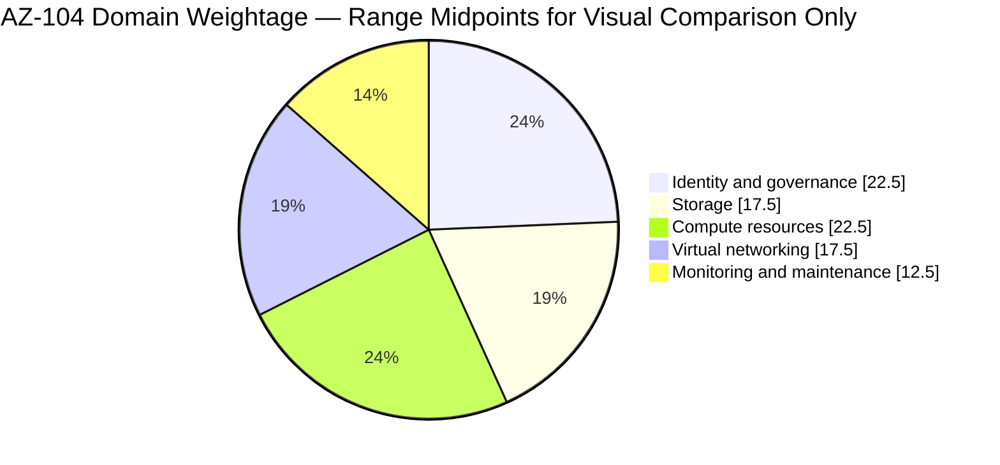
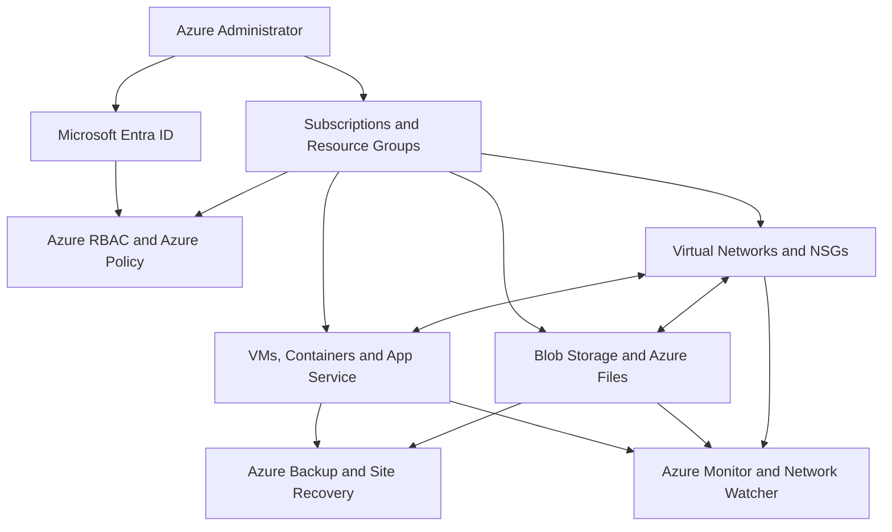
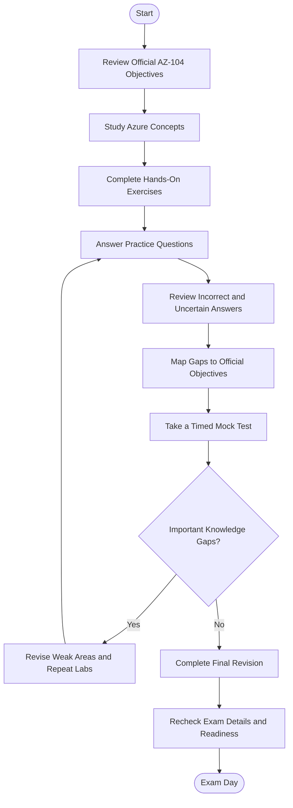
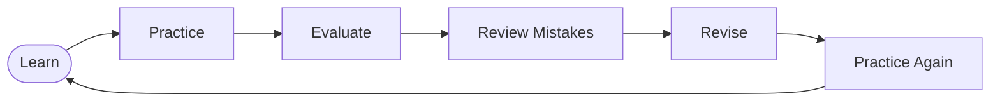
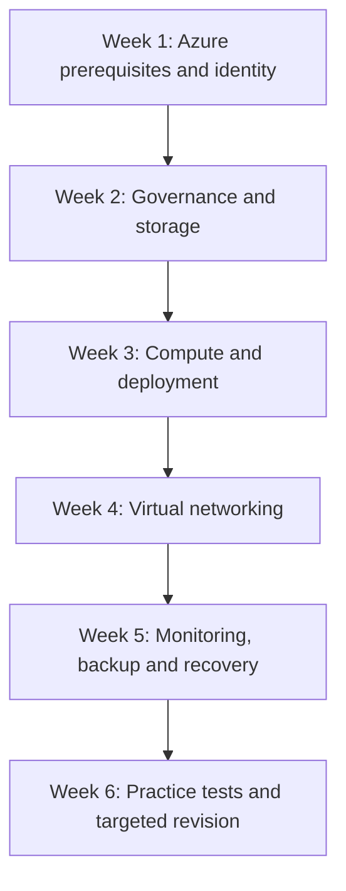

# Microsoft AZ-104: Azure Administrator Study Guide

A practical, community-oriented study guide for preparing for the **Microsoft AZ-104: Azure Administrator** exam. This repository organizes the official skills measured into manageable study areas, hands-on exercises, technical diagrams, original practice questions, and a structured revision plan.

The goal is to help learners understand how Azure resources work together—not simply memorize terminology. Use this guide alongside the official [Microsoft AZ-104 study guide](https://learn.microsoft.com/en-us/credentials/certifications/resources/study-guides/az-104), Microsoft Learn training, Azure documentation, and practical lab work.

---

## Table of Contents

- [About the AZ-104 Certification](#about-the-az-104-certification)
- [Who Should Prepare?](#who-should-prepare)
- [Exam Information](#exam-information)
- [Official Exam Objectives](#official-exam-objectives)
- [Exam Domain Weightage](#exam-domain-weightage)
- [Azure Administration Architecture](#azure-administration-architecture)
- [How to Prepare for AZ-104](#how-to-prepare-for-az-104)
- [Certification Preparation Flowchart](#certification-preparation-flowchart)
- [Circular Study and Revision Cycle](#circular-study-and-revision-cycle)
- [Suggested Six-Week Study Roadmap](#suggested-six-week-study-roadmap)
- [Hands-On Labs and Practical Projects](#hands-on-labs-and-practical-projects)
- [AZ-104 Practice Questions](#az-104-practice-questions)
- [Common Preparation Mistakes](#common-preparation-mistakes)
- [Career Relevance](#career-relevance)
- [Frequently Asked Questions](#frequently-asked-questions)
- [Official and Additional Learning Resources](#official-and-additional-learning-resources)
- [About CertsGate](#about-certsgate)

---

## About the AZ-104 Certification

**AZ-104** is the exam associated with the **Microsoft Certified: Azure Administrator Associate** certification. It assesses the practical knowledge required to implement, manage, and monitor Microsoft Azure environments.

Azure administrators work with identity and access, subscriptions, governance, storage, compute, virtual networks, monitoring, and recovery. These responsibilities often involve coordinating with networking, security, application development, database, and DevOps teams.

The exam is most useful when preparation includes both conceptual understanding and practical work in the Azure portal, Azure CLI, PowerShell, and infrastructure-as-code tools.

Official certification page: [Microsoft Certified: Azure Administrator Associate](https://learn.microsoft.com/en-us/credentials/certifications/exams/az-104/)

## Who Should Prepare?

This study guide is suitable for:

- IT professionals who administer cloud infrastructure.
- System administrators moving from on-premises environments to Azure.
- Junior cloud engineers building practical Azure skills.
- Technical support professionals expanding into cloud operations.
- Learners preparing for the Microsoft Azure Administrator Associate certification.

Microsoft recommends familiarity with operating systems, networking, servers, virtualization, Microsoft Entra ID, Azure portal administration, PowerShell, Azure CLI, and ARM templates or Bicep.

If Azure is new to you, begin with the [AZ-104 prerequisite learning path](https://learn.microsoft.com/en-us/training/paths/az-104-administrator-prerequisites/) and build foundational knowledge before attempting advanced labs.

## Exam Information

| Item | Details |
|---|---|
| Exam code | AZ-104 |
| Certification | Microsoft Certified: Azure Administrator Associate |
| Level | Intermediate |
| Main role | Azure Administrator |
| Skills measured version referenced here | April 17, 2026 |
| Exam time shown on the official certification page | 100 minutes |
| Passing score | 700 or greater on Microsoft's 1–1000 scale |
| Question count | Varies; check current Microsoft exam information |
| Renewal | Certification renewal is required periodically; Microsoft currently lists a 12-month renewal frequency |
| Official study guide | [Microsoft AZ-104 Study Guide](https://learn.microsoft.com/en-us/credentials/certifications/resources/study-guides/az-104) |

Microsoft exams can include different question types and may include interactive components. The number of questions, exam experience, language availability, fees, and policies can change. Verify the latest details on the [official AZ-104 page](https://learn.microsoft.com/en-us/credentials/certifications/exams/az-104/) before booking.

---

## Official Exam Objectives

Microsoft's published AZ-104 skills measured are organized into five domains. Use the current official study guide as the authoritative checklist for individual tasks and sub-objectives.

### 1. Manage Azure Identities and Governance — 20–25%

Focus on:

- Creating and managing Microsoft Entra users and groups.
- Managing user properties, licenses, external users, and self-service password reset.
- Assigning built-in Azure roles at appropriate scopes.
- Interpreting role assignments and access permissions.
- Managing subscriptions, resource groups, and management groups.
- Implementing Azure Policy and resource locks.
- Applying tags and managing costs through budgets, alerts, and Azure Advisor recommendations.

**Practice idea:** Create a resource group, assign a role at a suitable scope, apply a tag, and evaluate how a policy or lock affects resource management.

### 2. Implement and Manage Storage — 15–20%

Focus on:

- Creating and configuring storage accounts.
- Choosing appropriate redundancy options.
- Configuring storage firewalls and virtual network access.
- Working with shared access signature (SAS) tokens and access keys.
- Configuring identity-based access for Azure Files.
- Managing Azure Blob Storage containers, tiers, lifecycle policies, versioning, snapshots, and soft delete.
- Using Azure Storage Explorer and AzCopy.

**Practice idea:** Create a storage account and blob container, upload sample files, configure a lifecycle rule, and compare access methods.

### 3. Deploy and Manage Azure Compute Resources — 20–25%

Focus on:

- Creating and configuring virtual machines.
- Managing VM settings and related resources.
- Provisioning and managing containers through the Azure portal.
- Interpreting and modifying ARM templates or Bicep files.
- Provisioning and configuring App Service plans and App Services.
- Configuring scaling, TLS certificates, custom DNS names, backups, networking, and deployment slots for App Service.

**Practice idea:** Deploy a virtual machine, review its networking and management settings, and use a Bicep template to deploy a small, repeatable resource configuration.

### 4. Implement and Manage Virtual Networking — 15–20%

Focus on:

- Creating virtual networks and subnets.
- Configuring virtual network peering and public IP addresses.
- Configuring user-defined routes.
- Creating network security groups (NSGs) and application security groups.
- Evaluating effective NSG rules and troubleshooting connectivity.
- Implementing Azure Bastion, service endpoints, and private endpoints.
- Configuring Azure DNS and load balancers.
- Diagnosing load-balancing and name-resolution issues.

**Practice idea:** Build two virtual networks, configure peering, apply NSG rules, and test connectivity. Document which traffic is allowed or blocked and why.

### 5. Monitor and Maintain Azure Resources — 10–15%

Focus on:

- Interpreting Azure Monitor metrics.
- Configuring diagnostic and log settings.
- Querying and analyzing logs.
- Creating alert rules, action groups, and alert processing rules.
- Using Azure Monitor Insights and Network Watcher.
- Creating Recovery Services vaults and Azure Backup vaults.
- Configuring backup policies and performing restore operations.
- Configuring Azure Site Recovery and testing failover concepts.
- Reviewing backup reports and alerts.

**Practice idea:** Configure a monitoring alert, inspect the resulting data, and create a backup policy for a test resource where your environment supports it.

Official source: [AZ-104 skills measured](https://learn.microsoft.com/en-us/credentials/certifications/resources/study-guides/az-104)

---

## Exam Domain Weightage

The following chart uses the percentage ranges published in Microsoft's study guide. These are official exam-domain ranges, not a prediction of the exact number of questions you will receive.

**Important:** The chart uses the midpoint of each published range to compare domains visually. These midpoint values are not official fixed percentages and do not represent a guaranteed exam distribution. The five official ranges are:

| Official domain | Published range |
|---|---:|
| Manage Azure identities and governance | 20–25% |
| Implement and manage storage | 15–20% |
| Deploy and manage Azure compute resources | 20–25% |
| Implement and manage virtual networking | 15–20% |
| Monitor and maintain Azure resources | 10–15% |

Do not use the chart as a replacement for the detailed objective list. All domains matter, and smaller domains may contain important technical tasks.

---

## Azure Administration Architecture

Azure administration involves managing identities, permissions, resource organization, workloads, networking, and operational controls. The diagram below is a **conceptual study model**, not a prescribed architecture or an official exam blueprint.

### Understand the relationships

- **Microsoft Entra ID** manages identity authentication and directory objects.
- **Azure RBAC** controls what identities can do to Azure resources and at which scope.
- **Azure Policy** evaluates resources against organizational rules.
- **Resource groups and subscriptions** organize and govern Azure resources.
- **Virtual networks and NSGs** help control network connectivity.
- **Compute and storage** host applications and data.
- **Azure Monitor and Network Watcher** help investigate resource health and connectivity.
- **Azure Backup and Site Recovery** support recovery and continuity requirements.

A useful preparation habit is to explain how a configuration affects neighboring components. For example, a VM may be running correctly while a subnet route, NSG rule, DNS setting, or access assignment prevents the intended operation.

---

## How to Prepare for AZ-104

### Step 1: Start with the official objectives

Read the Microsoft study guide before choosing courses or practice material. Turn each listed task into a checklist and mark it as:

- **Not started:** The concept is unfamiliar.
- **Learning:** You understand the explanation but need practice.
- **Practiced:** You have configured or tested it yourself.
- **Ready to explain:** You can describe the purpose, configuration, limitations, and troubleshooting approach.

This makes preparation measurable without relying only on the number of videos watched or questions completed.

### Step 2: Learn one domain at a time

Follow Microsoft's learning paths and documentation. For each topic, identify the problem the Azure service solves, its important configuration options, its access requirements, and common failure scenarios.

Avoid jumping between unrelated subjects before you understand the basics. Build a foundation in identity and governance, then move through storage, compute, networking, and monitoring.

### Step 3: Practice in Azure

Use the Azure portal to understand the interface, but also become familiar with Azure CLI or PowerShell. Where appropriate, review ARM templates and Bicep to understand repeatable deployments.

Be careful with cloud costs. Use an authorized lab or subscription, check current pricing, remove resources when finished, and never place secrets or real sensitive data in practice configurations.

### Step 4: Use practice questions to find gaps

Practice questions are most useful when treated as diagnostic tools. For each answer:

1. Explain why the selected option is correct.
2. Explain why the alternatives do not meet the stated requirement.
3. Identify the relevant official objective.
4. Revisit documentation or repeat a lab if the concept remains unclear.
5. Retest the topic later using a different scenario.

Supplementary materials such as [CertsGate's AZ-104 preparation page](https://certsgate.com/exams/microsoft/az-104) can be used as another knowledge-check resource alongside Microsoft's official assessment and documentation.

### Step 5: Simulate exam conditions

Use timed practice to improve focus and decision-making. Review the official exam sandbox to become familiar with the exam interface and possible question styles. A good readiness signal is being able to solve unfamiliar scenarios and explain the reasoning, rather than recognizing memorized answers.

---

## Certification Preparation Flowchart

Use this workflow to keep preparation structured. If a knowledge gap remains, return to the relevant material before moving forward.

## Circular Study and Revision Cycle

Azure administration includes connected concepts. Repeating the learning cycle helps reinforce the relationship between theory, configuration, and troubleshooting.

Do not treat a single pass through a topic as proof of mastery. Return to topics where you guessed, struggled to explain the answer, or could not reproduce the configuration in a lab.

---

## Suggested Six-Week Study Roadmap

This is an independent study schedule, not an official Microsoft timeline. Adjust it based on your Azure experience, available study time, and results from practice assessments.

| Week | Main focus | Practical outcome |
|---|---|---|
| 1 | Azure fundamentals, Microsoft Entra ID, RBAC, subscriptions, resource groups | Explain access scopes and basic governance |
| 2 | Azure Policy, resource locks, tags, costs, storage accounts, Blob Storage and Azure Files | Configure storage and compare access options |
| 3 | Virtual machines, containers, App Service, ARM templates and Bicep | Deploy and review compute resources |
| 4 | Virtual networks, subnets, peering, NSGs, private endpoints, DNS and load balancing | Build and troubleshoot a small network |
| 5 | Azure Monitor, logs, alerts, Network Watcher, Azure Backup and Site Recovery | Configure monitoring and understand recovery workflows |
| 6 | Full objective review, practice assessments, mock tests and weak-area revision | Identify remaining gaps and make a readiness decision |

For every week, reserve time to revisit previous topics. Identity, network access, resource configuration, and monitoring often interact in real administrative scenarios.

---

## Hands-On Labs and Practical Projects

Practical work helps turn exam terminology into operational understanding. Use a sandbox or subscription where you have permission to create and remove resources.

### Project 1: Identity and governance baseline

**Tasks**
- Create a resource group for a test workload.
- Apply meaningful tags.
- Assign an appropriate built-in role at a suitable scope.
- Review role assignments and effective permissions.
- Explore how a resource lock or Azure Policy affects administration.

**Learning goal:** Understand the differences between identity, authorization, organization, and governance.

### Project 2: Storage account configuration

**Tasks**
- Create a storage account and Blob Storage container.
- Compare redundancy options in the portal and documentation.
- Review access keys, SAS, and identity-based access.
- Configure blob versioning or soft delete where available.
- Explore a lifecycle management policy.

**Learning goal:** Select access and data-protection settings based on a scenario rather than memorizing isolated definitions.

### Project 3: Network connectivity troubleshooting

**Tasks**
- Create a virtual network with at least two subnets.
- Attach an NSG and inspect inbound and outbound rules.
- Review routes and name resolution.
- If your lab supports it, configure peering or a private endpoint.
- Use available diagnostics to investigate an intentionally restricted connection.

**Learning goal:** Identify whether a connectivity problem relates to routing, filtering, addressing, DNS, or service configuration.

### Project 4: Compute deployment and monitoring

**Tasks**
- Deploy a test VM or App Service.
- Review its network and access configuration.
- Configure available monitoring or diagnostic settings.
- Create an alert where supported.
- Explore backup options and document a recovery procedure.

**Learning goal:** Connect deployment, observability, and recovery instead of treating them as separate administrative tasks.

### Project 5: Repeatable deployment

**Tasks**
- Inspect a simple ARM template or Bicep file.
- Identify its parameters, resources, and dependencies.
- Make a safe change in a test environment.
- Deploy the template and verify the result.

**Learning goal:** Understand how infrastructure-as-code supports consistent and repeatable Azure administration.

Always clean up resources when the exercises are complete. Some services can incur charges even when they are not actively being used.

---

## AZ-104 Practice Questions

The following are **original illustrative study questions**, written for this repository. They are not official Microsoft exam questions and are not represented as actual exam content.

### Question 1: Azure RBAC

An administrator needs to give a team permission to manage resources in one resource group without granting the same access across the subscription. What should the administrator consider?

A. Assign the role at the subscription scope  
B. Assign an appropriate Azure role at the resource-group scope  
C. Create a storage account access key  
D. Configure a blob lifecycle policy  

**Answer: B**

**Explanation:** Azure RBAC assignments can be scoped to a resource group. Choosing the narrowest scope that meets the requirement helps follow least privilege.

### Question 2: Blob Storage

A storage administrator wants to automate the movement or deletion of blob data according to its age. Which feature should be investigated?

A. Azure Bastion  
B. Azure Policy  
C. Blob lifecycle management  
D. Virtual network peering  

**Answer: C**

**Explanation:** Blob lifecycle management supports rule-based data management actions. The appropriate policy depends on the storage requirements and supported conditions.

### Question 3: Network security

A VM is running, but a connection to a required service is blocked. Which action is a reasonable first step?

A. Delete the subscription  
B. Review relevant NSG rules, effective security rules, routes, and service connectivity  
C. Change every resource tag  
D. Disable all monitoring  

**Answer: B**

**Explanation:** Connectivity issues can have several causes. Investigate the path and applicable security rules rather than changing unrelated settings.

### Question 4: Monitoring

An administrator needs to notify a team when an Azure Monitor alert condition is met. Which configuration should be considered?

A. An action group associated with the alert rule  
B. A storage lifecycle rule  
C. A resource tag alone  
D. A virtual network peering connection  

**Answer: A**

**Explanation:** Action groups define the notification or action behavior used by supported Azure Monitor alerts.

### Question 5: Infrastructure as code

A team wants to deploy a repeatable Azure configuration using a declarative template language. Which options are relevant to AZ-104 preparation?

A. Bicep and Azure Resource Manager templates  
B. Only blob snapshots  
C. Only Azure DNS records  
D. Only NSG flow troubleshooting  

**Answer: A**

**Explanation:** Microsoft's AZ-104 objectives include interpreting and modifying ARM templates or Bicep files.

### How to review your answers

For each question, identify the objective, explain why the correct option fits, and explain why the other choices do not. Then reproduce the relevant configuration in a lab if possible. A correct guess is not the same as a reliable understanding.

Use Microsoft's [free AZ-104 Practice Assessment](https://learn.microsoft.com/en-us/credentials/certifications/exams/az-104/) as an official additional check. Third-party practice material can supplement your study, but it should not replace current objectives, technical documentation, or hands-on learning.

---

## Common Preparation Mistakes

### Memorizing answers instead of learning the service

Recognizing an answer from a practice set does not guarantee that you can solve a different scenario. Focus on the underlying requirement and why a solution works.

### Ignoring the official objective list

Study materials can be outdated. Compare every course, question set, and checklist with the current Microsoft study guide.

### Skipping hands-on practice

Portal settings, permissions, networking, deployment options, and troubleshooting become easier to understand when you have configured them yourself.

### Confusing similar Azure features

For example, Azure RBAC and Azure Policy serve different purposes. RBAC governs permitted actions; Policy evaluates resource compliance against defined rules. Learn these distinctions through practical scenarios.

### Neglecting monitoring and recovery

Monitoring, alerts, backup, and Site Recovery are explicit AZ-104 domains. Include them in the plan rather than focusing only on deployment.

### Treating mock-test scores as a guarantee

Practice results are indicators, not a promise of an exam outcome. Review weak areas and verify that you can explain the concepts without relying on answer memorization.

### Forgetting cost and security controls in labs

Use least privilege, protect credentials, avoid real sensitive data, and remove resources after testing. Practical learning should follow responsible cloud administration.

---

## Career Relevance

The AZ-104 certification aligns with the work of Azure administrators and can help structure learning for cloud operations roles. Its subject areas are also relevant to system administrators and infrastructure professionals who work with Microsoft Azure.

The practical skills covered in this guide—identity management, resource governance, compute deployment, storage configuration, networking, monitoring, and recovery—are useful beyond the exam itself.

A certification is one way to demonstrate knowledge, but employers may also evaluate practical experience, troubleshooting ability, communication, scripting, and familiarity with production operating procedures.

---

## Frequently Asked Questions

### What is the AZ-104 exam?

AZ-104 is the exam for the Microsoft Certified: Azure Administrator Associate certification. It evaluates Azure administration skills across identity and governance, storage, compute, networking, and monitoring and maintenance.

### What is the passing score for AZ-104?

Microsoft lists **700 or greater** as the passing score on its 1–1000 scoring scale. Check the [official exam page](https://learn.microsoft.com/en-us/credentials/certifications/exams/az-104/) for current exam information.

### How long is the AZ-104 exam?

The official AZ-104 page currently lists 100 minutes for the assessment. Microsoft distinguishes exam time from total seat time, and exam experiences can vary. Check the current exam details before your appointment.

### How many questions are on AZ-104?

The exact number can vary. Microsoft states that question counts are subject to change. Avoid relying on unofficial fixed counts as a guarantee of what you will receive.

### Is hands-on Azure experience important?

Yes. Microsoft's audience profile recommends familiarity with Azure administration tools and related infrastructure concepts. Hands-on practice helps learners understand configuration, dependencies, and troubleshooting.

### Are third-party AZ-104 practice questions enough?

They should not be your only resource. Use them to test understanding and identify gaps, then validate your knowledge with official objectives, Microsoft Learn, Azure documentation, and labs.

### How should I know when I am ready?

You should be able to explain the official objectives, configure important services in a suitable lab, solve unfamiliar scenarios, understand incorrect answers, and perform consistently in practice assessments. No readiness method guarantees a passing result.

### Does the certification need renewal?

Microsoft currently lists a 12-month renewal frequency for Azure Administrator Associate. Review the official certification page for the applicable renewal process and requirements.

---

## Official and Additional Learning Resources

Use official Microsoft resources as the foundation of your AZ-104 preparation.

| Resource | How to use it |
|---|---|
| [AZ-104 Certification Page](https://learn.microsoft.com/en-us/credentials/certifications/exams/az-104/) | Confirm current certification and exam details |
| [AZ-104 Study Guide](https://learn.microsoft.com/en-us/credentials/certifications/resources/study-guides/az-104) | Review the current skills measured and supporting links |
| [Microsoft Azure Administrator Learning Collection](https://learn.microsoft.com/en-us/training/courses/az-104t00) | Explore structured administrator training |
| [Microsoft Learn](https://learn.microsoft.com/en-us/training/azure/) | Find Azure learning paths and modules |
| [Azure Documentation](https://learn.microsoft.com/en-us/azure/) | Research service behavior and configuration |
| [Microsoft Entra Documentation](https://learn.microsoft.com/en-us/entra/) | Study identity and access concepts |
| [Azure Storage Documentation](https://learn.microsoft.com/en-us/azure/storage/) | Learn about storage accounts, blobs, and Azure Files |
| [Azure Virtual Network Documentation](https://learn.microsoft.com/en-us/azure/virtual-network/) | Review networking, subnets, peering, and related features |
| [Azure Monitor Documentation](https://learn.microsoft.com/en-us/azure/azure-monitor/) | Study metrics, logs, alerts, and monitoring |
| [Azure Backup Documentation](https://learn.microsoft.com/en-us/azure/backup/) | Learn about backup and restore |
| [Microsoft Exam Sandbox](https://learn.microsoft.com/en-us/credentials/certifications/exams/az-104/) | Familiarize yourself with the exam interface |
| [CertsGate AZ-104 Page](https://certsgate.com/exams/microsoft/az-104) | Explore supplementary certification-preparation material |

If a training link changes, navigate from the official AZ-104 study guide or certification page to find the current resource.

---

## About CertsGate

[CertsGate](https://certsgate.com/) provides supplementary IT certification preparation resources. Learners preparing for AZ-104 can explore the [CertsGate AZ-104 page](https://certsgate.com/exams/microsoft/az-104) as an additional way to review concepts and check their knowledge.

Use third-party study material alongside the official Microsoft objectives, documentation, practice assessment, and practical exercises. Check the relevance and accuracy of any supplementary material against the current exam version, and focus on understanding why a solution is appropriate.

